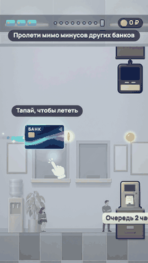
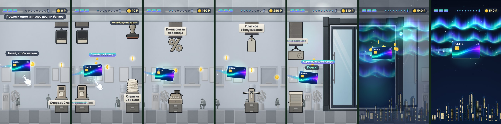
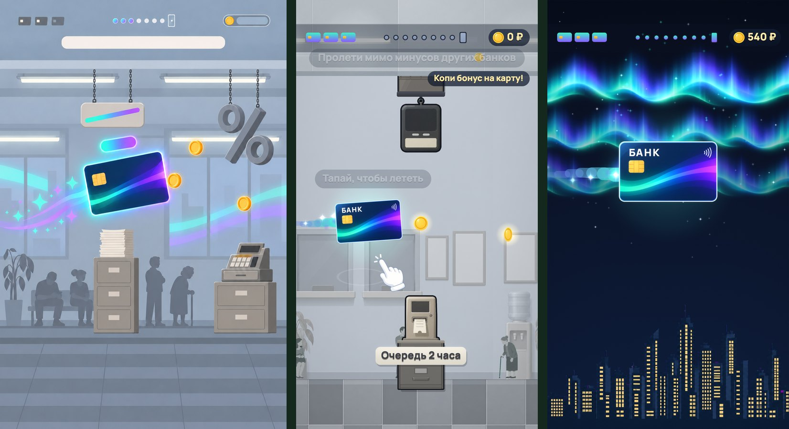

# Полёт карты — playable-реклама банка «БАНК»

**▶ Играть в браузере / с телефона:** https://bankaino.github.io/card-flight-playable/
(A/B-варианты: [gates5](https://bankaino.github.io/card-flight-playable/gates5.html), [noplus](https://bankaino.github.io/card-flight-playable/noplus.html), [nobonus](https://bankaino.github.io/card-flight-playable/nobonus.html)). Тап, клик или пробел — подбросить карту; звук включается после первого касания.

 авто-прогон, 19 с до эндкарда

Портретная 2D playable-реклама в механике Flappy Bird: банковская карта пролетает через серое отделение «банков-конкурентов», где на каждом препятствии написан минус — «Очередь 2 часа», «Справка из 5 мест», «Комиссия за переводы». Пролетел — минус зачёркнут, а на его месте всплывает плюс банка. По дороге карта копит монеты-бонус, после восьмых ворот открываются стеклянные двери, мир превращается в ночное небо с северным сиянием, а на эндкарде игрок забирает собранную сумму и кэшбэк 10 %.

Весь пайплайн — от референса до билдов — пройден собственными скиллами для Claude Code.

От концепт-кадра до игры (слева сгенерированный концепт, дальше кадры игры):

## Как играть

1. Тап — карта подпрыгивает, иначе падает. Мир едет влево, скорость растёт от 400 до 470 px/с.
2. Восемь ворот: сверху воздуховод с предметом на цепи, снизу предмет на шкафах, между ними проход. На плашке написан минус. Пролетел — полоса зачёркивает его, всплывает плюс («Онлайн за 5 минут», «Кэшбэк до 10 %»…), три монеты летят в счётчик.
3. Три жизни (три мини-карты в углу). Удар о препятствие или пол — отскок, красная вспышка, летят бумажки, карта мигает и неуязвима 1.2 с. Первые 2 секунды удар жизнь не снимает.
4. Жизни кончились — «Карта застряла в очереди», «Ещё раз» (или тап в любое место) начинает с первых ворот; каждая новая попытка незаметно легче (проходы шире на 130 px за попытку). Под кнопкой — «Оформить карту», чтобы у тех, кто застрял, был путь в магазин.
5. После восьмых ворот открываются двери, карта вылетает в ночь: белая вспышка, фонтан монет, шесть залпов салюта, и эндкард: «Вам начислено N ₽» (сумма, собранная в полёте), «+ кэшбэк 10 % первые 3 месяца», кнопка «Забрать N ₽». Если собрано меньше 100 ₽, героем остаётся «Кэшбэк 10 %» и кнопка «Оформить карту».

Рядом с картой есть «почти-задел»: если рисунок карты чиркнул по краю, а хитбокс нет, вылетают искры и всплывает «Почти!».

## Что внутри за 19 секунд (авто-прогон)

| время от первого тапа | бит | что видит зритель |
|---|---|---|
| до тапа | хук | серое отделение, мерцают лампы, ожидающие силуэты, яркая карта парит; «Пролети мимо минусов других банков», плашка «Тапай, чтобы лететь», рука-подсказка |
| 1.9 с | ворота 1 | «Очередь 2 часа» зачёркнуто, чип «Онлайн за 5 минут», первые монеты, подсказка «Копи бонус на карту!» |
| 3.8–9.4 с | ворота 2–5 | ритм ≈ 1.85 с, проходы сужаются, перепады высоты растут |
| 11.1 с | «Ещё немного!» | осталось два прохода, сквозь стены начинает просвечивать сияние |
| 12.8, 14.5 с | ворота 7–8 | самые узкие, в демо-прогоне здесь два «почти-задела» |
| 15.3 с | двери | створки уезжают, за ними сияние |
| 16.2–18.9 с | финал | вспышка, фонтан монет, салют, карта плывёт в центр |
| 18.9 с | эндкард | «Вам начислено 540 ₽», «Забрать 540 ₽», «Ещё раз» |

## Числа

- Карта 290 × 183 px (27 % ширины экрана), хитбокс 232 × 124 (прощающий). Вид 1080 px в ширину, высота по телефону (16:9 … 19.5:9).
- Подскок 1150 px/с при гравитации 3600 px/с²: высота подскока ≈ 184 px. Ворота через 780 px, проходы от 650 до 500 px.
- Монет 16 по 20 ₽, за пролёт ворот +30 ₽: максимум 560 ₽.
- Скрытая помощь, не трогающая скорость: +130 px к проходам за каждую новую попытку (до +260 px) и +50 px впереди после двух ударов подряд.

## A/B-варианты

| вариант | что меняется | гипотеза |
|---|---|---|
| `gates8` (основной) | 8 ворот | достаточно вызова, чтобы сообщение «у других — минусы» успело прозвучать, а путь до оффера ≈ 20 с |
| `gates5` | 5 ворот | короче путь — больше игроков видят оффер и жмут CTA |
| `noplus` | без чипов-плюсов в полёте | меньше текста — игроку легче, а оффер в финале ярче |
| `nobonus` | без бонуса за монеты, герой эндкарда «Кэшбэк 10 %» | личная сумма может отвлекать от главного оффера |
| `adnet` | постоянная кнопка магазина и таймеры эндкарда | сборка под правила сетей (в браузерную демо-страницу не входит) |

Сравнивать стоит долю досмотра до эндкарда, CTR кнопок «Забрать N ₽» / «Оформить карту», долю «Ещё раз».

## Темп (прогон 1 000 «игроков» без браузера)

`node tools/bots.mjs 1000 [--k KEY=VAL]` — боты тапают с человеческой реакцией (0.12–0.34 с), шумом прицеливания и пальцем, который не нажимает чаще, чем раз в 0.17–0.30 с; 15 % «спамят» тапами, 15 % реагируют с опозданием, 8 % бросают после первого провала.

| метрика | `gates8` | `gates5` |
|---|---|---|
| с первой попытки до эндкарда | 70 % | 84 % |
| за ≤ 3 попытки | 92 % (+2 % бросили) | 97 % |
| от старта до эндкарда, медиана | 20.7 с | 15.1 с |
| провал на первых воротах | 0 % | 0 % |

`tools/smoke_test.mjs` играет собранную игру на телефонном экране настоящими касаниями до эндкарда, нажимает кнопку магазина и проверяет отсутствие внешних запросов и ≥ 50 кадров/с.

## Картинка и звук

Плоский вектор с мягкими тенями: серое отделение для «банков-конкурентов» (приглушённое, нарочито скучное), карта — единственный яркий объект; препятствия обведены тёмным контуром и темнее фона, чтобы читались с первого взгляда. Все спрайты (карта, монета, 16 предметов, шкафы, воздуховоды, двери, город, сияние) сгенерированы; плашки, надпись «БАНК» на карте и весь интерфейс рисуются кодом.

Звук процедурный (WebAudio, без файлов): в отделении играет нарочито унылая «музыка ожидания на линии» (90 BPM, фильтр открывается по мере приближения к двери), после дверей — яркий пэд и арпеджио (110 BPM). Монеты звучат по пентатонике, высота растёт с серией.

## Сборки

`python3 tools/build_playable.py --variant all` (нужен Python 3 и Pillow) собирает в `dist/<вариант>/` одиночные HTML-файлы для AppLovin, Unity Ads, ironSource, Mintegral, Meta, Google (zip) и предпросмотр; отчёт с размерами — `dist/<вариант>/report.md`. Сейчас каждая сборка ≈ 0.63 МБ (Google zip 0.42 МБ) при лимите Meta 2 МБ.

## Как адаптировать под реального клиента

- **Ссылка магазина:** `tools/build.json` → `store` (сейчас заглушка `https://example.com/karta`).
- **Оффер и тексты:** строки минусов и плюсов, эндкард — в начале `live/scene.js` (`MINUS`, `PLUS`, блок «endcard»); сумма и минимум бонуса — `K.BONUS`, `K.COIN_V`, `K.GATE_V`, `K.BONUS_MIN` в `live/sim.js`. Реальные условия бонуса и юридический текст задаёт заказчик.
- **Бренд:** цвета и шрифт — `live/skin.js` (пресет `bank`); надпись на карте — `bakeMark()` в `live/scene.js`; арт — `art/prompts/` и `art/gen/`.
- **Маркировка рекламы** (РФ: «Реклама», рекламодатель, erid) в игру не вшита: её подставляет площадка или заказчик.
- **Сложность:** `K.GAP`, `K.OFF`, `K.SPD0/SPD1`, `K.MERCY_*`; после правок — `node tools/bots.mjs 1000`.

## Технически

Один HTML без внешних библиотек: WebGL2-движок на ~500 строк, детерминированная симуляция 120 Гц (`live/sim.js`), сцена — чистая функция времени и состояния (`live/scene.js`), звук — `live/audio.js`. Шрифт Manrope (OFL, `licenses/`), подмножество встроено. Внешних запросов нет.
